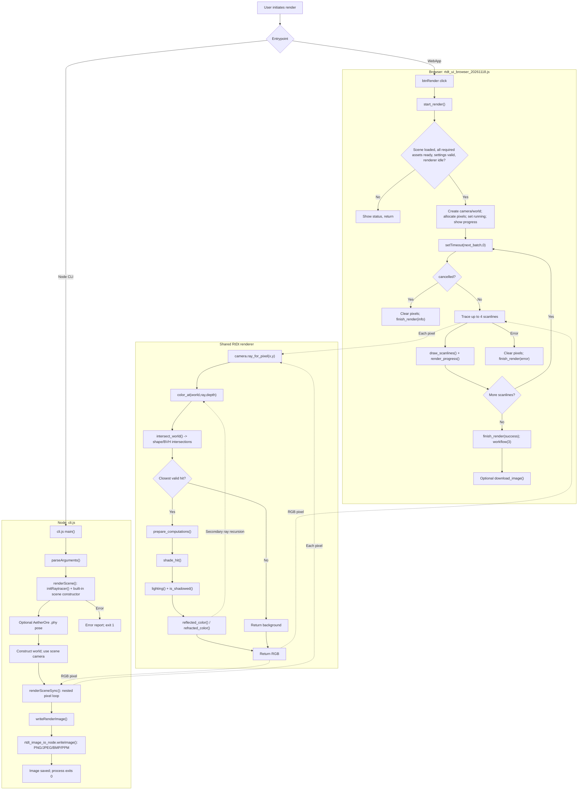

# RtDt render control flow

This is the implemented control graph for the current WebApp and root Node CLI entrypoints, not a proposed refactor. Both routes share `camera.ray_for_pixel()`, `color_at()`, intersection/BVH and lighting functions, but own separate render loops.

## Entry and output differences

| | WebApp | Node CLI |
| --- | --- | --- |
| Entrypoint | `btnRender` → `start_render()` | `main()` → `renderScene()` |
| Initialization | Requires loaded scene and all required assets | Runs a named built-in scene constructor; optional `.phy` pose |
| Render loop | `next_batch()`, up to four scanlines per event-loop tick | `renderSceneSync()`, synchronous pixel loop |
| Pixel path | `camera.ray_for_pixel()` → `color_at()` | Same |
| Output | Accumulate `pixels[]`, draw batches to canvas; download separately | `writeRenderImage()` selects encoder from extension |
| Cancellation | `cancel_render()` sets a flag checked between batches | Process termination; no scanline-level cancel path |
| Success | `finish_render('Render complete…','success')` | Image saved and exit code 0 |
| Errors | Batch-level catch → status message | Render-level catch → stderr and exit code 1 |

## Refactor watchpoints

- `start_render()` rebuilds the camera using `previous.field_of_view` but the camera object uses `previous.fov`; this can lose scene-defined field of view.
- Recursive shading decrements `remaining` at several levels (`color_at`, `shade_hit`, `reflected_color`, `refracted_color`); a bounce-depth review is needed.
- WebApp and CLI duplicate pixel-loop orchestration; the shared code is the actual per-ray path, not the render scheduler.
- AetherOre currently applies transform tracks to shape bindings. Camera flight tracks need a camera-aware binding and application path, not only a UI control.

See [Coding style](Coding-style.md).
